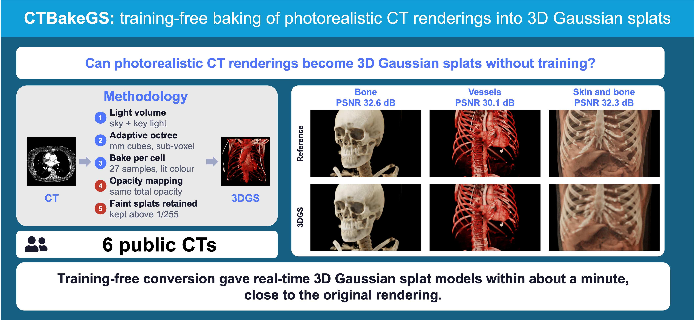

# CTBakeGS

Training-free conversion of photorealistic CT volume renderings into 3D Gaussian splats. The lighting of the photorealistic
volume rendering is baked into the splats, which are saved as a standard `.ply` / `.spz` file for common 3DGS viewers.

Everything runs locally in the browser in a single HTML file.

> For research and education only. Not for diagnosis or treatment decisions.

## Use

Open `CTBakeGS.html` in a recent desktop Chrome or Edge, open a CT (DICOM or NIfTI), choose a look, and press
*Convert to 3DGS*. Export `.ply` or `.spz`.

On Windows, the first start can take about a minute while the browser prepares the GPU programs; later starts
are fast.

## Version
Version 1.0 (2026-10-21)

## Reproducing the paper

Open `CTBakeGS.html?study=1`, run the study on the six TotalSegmentator CTs, then run
`evaluation/ctbakegs_tables_figures.py`. See [`evaluation/README.md`](evaluation/README.md).

## Authors 
Haruki Fukuda, Constantin Lux, Wolf Schweitzer, Tadashi Hosoya , Lars Ebert.

## License

MIT (see `LICENSE`). Third-party components are listed in `THIRD_PARTY_NOTICES.md`.
